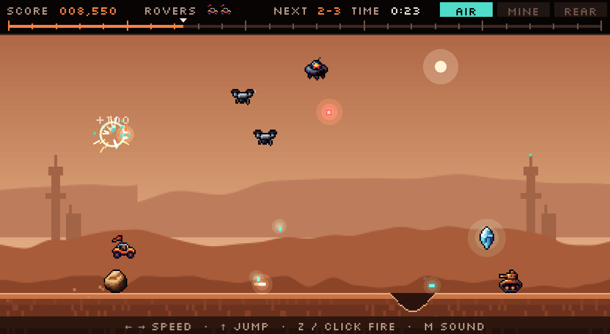

<div align="center">

# Mars Patrol

**Jump the craters. Shoot the machines. Mind the mines.**

A side-scrolling rover patrol across five sectors of Mars. It runs in the browser on desktop, gamepad or phone.

### [▶ Play it now](https://leeeeeroyj.github.io/mars-patrol/)

[](https://github.com/leeeeeroyj/mars-patrol/actions/workflows/deploy.yml)


[](LICENSE)



</div>

## About

Mars Patrol is an original arcade game inspired by the mechanics of Irem's arcade game *Moon Patrol*. Your rover drives the patrol route from Chryse Flats to the Olympus approach, past craters, boulders, buried charges and machines on the ground and in the sky. Reach every relay beacon before you run out of rovers.

- **Five sectors, 15 beacons, about three minutes a lap.** Each sector brings one new idea and shows it to you alone first, then builds set pieces from it: gauntlets, mine runs, air raids. Finish the route and it starts over on the Dusk shift, faster and more crowded.
- **Two guns at once, one cannon to keep cool.** Every shot fires forward along the road and straight up into the sky. Hold the trigger and the cannon overheats and jams, so pick your shots.
- **Speed is your wager.** Points are doubled at cruise and tripled when you boost, with less time to react. Brake for a safe ×1.
- **A road you can learn.** Each sector is laid out from a fixed seed, so a retry gives you the same road. Every Dusk lap lays the route out afresh.
- **Effects, sound and music, all in code.** Spark bursts, shockwave rings and screen shake on every kill, and a flash and camera roll when you lose a rover. Every sound effect and both music loops (one for the Day shift, one for Dusk) are generated in code when the game loads.
- **A living skyline.** Dust devils wander the plain by day, ice clouds drift overhead, and at Dusk meteors streak down and Earth shows as the evening star.
- **Plays anywhere.** Keyboard and mouse, an Xbox-style controller, or touch on a phone held sideways.

## How to play

The rover drives itself. Brake or boost to set its speed, jump over what's on the road, and shoot what's in the way.

- **Beacons are checkpoints.** Each sector has three. When you lose a rover, you start again from the last beacon you passed.
- **Speed multiplies your points.** Braking scores ×1, cruising ×2 and boosting ×3, shown as **SPEED** at the top. Clearing a sector adds a flat 1,000.
- **Mind the heat.** The gauge under the rover fills as you fire. Tap and it never fills; hold the trigger for about two seconds and the cannon jams for a second.
- **Don't shoot the mines** (unless you mean to). A shot arms a seed charge: it beeps, leaps up over you and drops. Brake or boost the moment it leaps and it lands clear, or shoot it out of the air for 300. Leave it alone and it's just something to jump.
- **Grab the ice cores.** They float over craters, rocks and mines, so you grab one by jumping something at the right moment. Each one vents the cannon and gives 3 seconds of **overdrive**: twice the fire rate and no heat.
- **Finish the route** for a 5,000 bonus. Then the Dusk shift begins: the five sectors again with a new layout, the machines 25% faster each lap and hazards closer together.
- **Watch the lamps.** **AIR** lights up when something is coming from above, **MINE** when seed charges are ahead, and **REAR** when a dozer is coming up behind you.
- **Rovers:** you start with 3 and get an extra one at 20,000, 50,000 and 100,000 points. At game over you can continue from the start of the sector, with a full set of rovers and the score back at zero.
- **High score:** your best is kept in this browser and shown on the title. Game over says so when you beat it, and leaving a run for the title counts too.
- **Attract mode:** add `?attract` to the address for a silent demo that drives, jumps and shoots by itself from a different sector each time, and ignores input. `?attract&seed=<n>` repeats the same demos.

| On the road | Jumped | Shot | Behaviour |
| --- | ---: | ---: | --- |
| Crater | – | – | Can't be shot. Jump it. |
| Boulder | 100 | 100 | Jump it or blast it. |
| Big boulder | 100 | 100 + 100 | Half again as big, and hard to jump unless you're boosting. The first hit breaks it down to a boulder. From Tharsis Rise on. |
| Rolling boulder | 100 | 150 | Rolls at you from up ahead, bouncing. Jump it or blast it. From Tharsis Rise on. |
| Seed charge | 50 | 300 in the air | Buried in the road, sometimes in pairs with room to land between them. Jump it. Shoot it and it arms, leaps and drops on you. From Ares Vallis on. |
| Harvester | 100 | 300 | Crawls toward you, firing shells along the road. A shell cancels your forward shot. From Noctis Labyrinth on. |
| Dozer | 100 | 200 | Comes up from behind. Jump it as it passes, or shoot it once it's ahead. From Noctis Labyrinth on. |
| Ice core | 250 | – | Floats over a hazard. Jump to grab it: it vents the cannon and gives 3 s of overdrive. |

| In the sky | Points | Behaviour |
| --- | ---: | --- |
| Survey drone | 100 | Comes in threes, weaving back and forth over the rover and dropping pellets. |
| Grader saucer | 200 | Hovers ahead of you and drops three charges that blast new craters into the road. |
| Relay satellite | 300 | Glides over the rover, hangs there flashing, then plunges straight down. |

Your upward shots also destroy falling pellets, charges and leaping seed charges. Every number in these tables is multiplied by your speed (×1, ×2 or ×3); the sector and route bonuses aren't.

## Controls

| | Keyboard + mouse | Controller | Touch |
| --- | --- | --- | --- |
| Brake / boost | ← → or A D | Left stick or D-pad | ◀ ▶ |
| Jump | ↑, W, Space or right click | A | **JUMP** |
| Fire | Z, J, X or left click | X, RT or RB | **FIRE** |
| Pause | P or Esc | Start | Tap **II PAUSE** (bottom right) |
| Sound and music on / off | M | Y | Tap **SOUND** (bottom right) |
| After game over | Enter to continue, Esc for the title | A to continue, B for the title | **CONTINUE** or **TITLE** |

The patrol pauses itself if you switch away. From the pause panel, resume, or go back to the title. Hold jump to keep jumping. On a phone, turn the screen sideways. On wide screens the touch buttons sit in the empty space beside the game, so they don't cover the road.

## Run it locally

You need [Node.js](https://nodejs.org/) 20.19+ or 22.12+.

```bash
npm install
npm run dev        # http://localhost:5173
npm run build      # type-check and build to dist/
```

Every push to `main` builds the game and deploys it to GitHub Pages.

## Project layout

```
src/
  main.ts            game setup
  config.ts          tunables: speeds, points, sectors, colours
  course.ts          seeded course generator (hazards, beacons, par times)
  backdrop.ts        sky, parallax hills and the road, in day and dusk palettes
  controls.ts        keyboard, mouse and gamepad input
  touch.ts           on-screen touch buttons
  effects.ts         spark bursts, shockwave rings, glows, screen shake
  sfx.ts             procedural sound effects
  music.ts           the Day and Dusk music loops, written out as notes and rendered in code
  hi.ts              the high score, kept in localStorage
  attract.ts         the ?attract demo mode's settings
  scenes/            title screen, patrol and HUD
assets/sprites/      the game's 16 × 16 sprites
design/              concept sheet and build plan
tools/sprites.py     sprite search and export script
tools/cdp.mjs        headless Chrome harness for the tests
tools/*-test.mjs     checks: pause and high score, the ?attract demo, the heat / speed / mine / ice loop
```

## Credits

- **Sprites:** from the CC0 [Angais/pixel-art-atlas-1.4m](https://huggingface.co/datasets/Angais/pixel-art-atlas-1.4m) collection of AI-generated pixel art, found with [Pixel Search](https://huggingface.co/spaces/cfahlgren1/pixel-search).
- **Font:** [Silkscreen](https://fonts.google.com/specimen/Silkscreen) by Jason Kottke (SIL Open Font License).
- **Engine:** [Phaser](https://phaser.io/).
- **Inspiration:** Irem's *Moon Patrol* arcade game. Mars Patrol is an original game and isn't affiliated with or endorsed by the original's rights holders.

## License

The code is released under the [MIT License](LICENSE). The sprites in `assets/sprites/` and `design/` are CC0 (public domain), and the Silkscreen font is under the SIL Open Font License.
