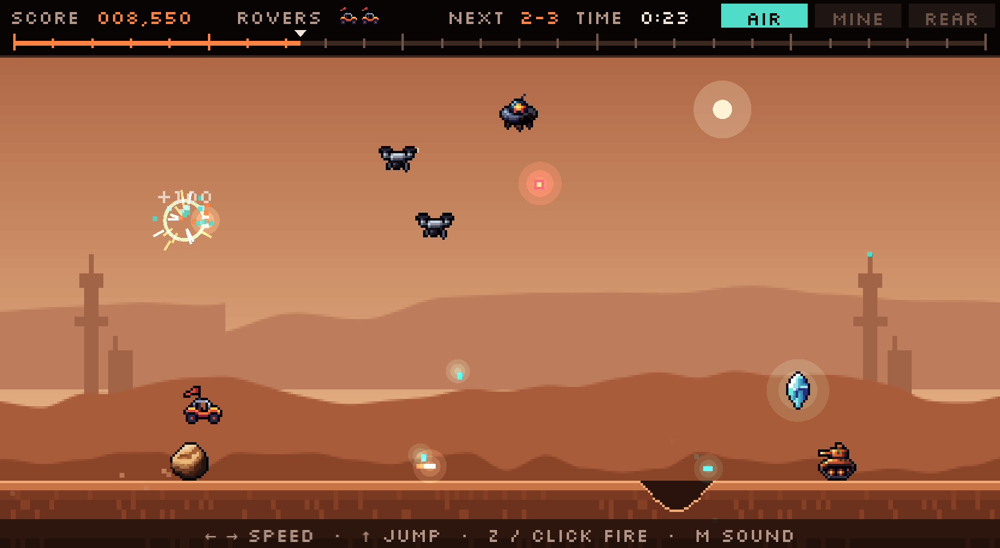

<div align="center">

# Mars Patrol

**Jump the craters. Shoot the machines. Beat par.**

A side-scrolling rover patrol across five sectors of Mars. It runs in the browser on desktop, gamepad or phone.

### [▶ Play it now](https://leeeeeroyj.github.io/mars-patrol/)

[](https://github.com/leeeeeroyj/mars-patrol/actions/workflows/deploy.yml)


[](LICENSE)



</div>

## About

Mars Patrol is an original arcade game inspired by the mechanics of Irem's arcade game *Moon Patrol*. Your rover drives the patrol route from Chryse Flats to the Olympus approach, past craters, boulders, buried charges and machines on the ground and in the sky. Reach every relay beacon before you run out of rovers.

- **Five sectors, 25 beacons.** New hazards join as you go, and the hills and the volcano on the skyline change as you go. Finish the route and it starts over on the Dusk shift, faster and more crowded.
- **Two guns at once.** Every shot fires forward along the road and straight up into the sky, so you're always watching both.
- **A road you can learn.** Each sector is laid out from a fixed seed, so a retry gives you the same road. Every Dusk lap lays the route out afresh.
- **Effects and sound, all in code.** Spark bursts, shockwave rings and screen shake on every kill, and a flash and camera roll when you lose a rover. Every sound effect is generated in code, sfxr style, when the game loads.
- **Plays anywhere.** Keyboard and mouse, an Xbox-style controller, or touch on a phone held sideways.

## How to play

The rover drives itself. Brake or boost to set its speed, jump over what's on the road, and shoot what's in the way.

- **Beacons are checkpoints.** Each sector has five. When you lose a rover, you start again from the last beacon you passed.
- **Beat par.** Clearing a sector scores 1,000, plus 100 for every second under par. The sector clock turns red once you're over.
- **Finish the route** for a 5,000 bonus. Then the Dusk shift begins: the five sectors again with a new layout, the machines 25% faster each lap and hazards closer together.
- **Watch the lamps.** **AIR** lights up when something is coming from above, **MINE** when seed charges are ahead, and **REAR** when a dozer is coming up behind you.
- **Rovers:** you start with 3 and get an extra one at 10,000, 30,000 and 60,000 points. At game over you can continue from the start of the sector, with a full set of rovers and the score back at zero.

| On the road | Jumped | Shot | Behaviour |
| --- | ---: | ---: | --- |
| Crater | – | – | Can't be shot. Jump it. |
| Boulder | 100 | 100 | Jump it or blast it. |
| Big boulder | 100 | 200 | Takes two hits. |
| Seed charge | 50 | – | Buried in the road, sometimes in pairs with room to land between them. Can't be shot. Jump it. |
| Harvester | 100 | 300 | Crawls toward you, firing shells along the road. A shell cancels your forward shot. |
| Dozer | 100 | 200 | Comes up from behind. Jump it as it passes, or shoot it once it's ahead. |
| Ice core | 250 | – | Floats above the road. Jump to grab it. |

| In the sky | Points | Behaviour |
| --- | ---: | --- |
| Survey drone | 100 | Comes in threes, weaving back and forth over the rover and dropping pellets. |
| Grader saucer | 200 | Hovers ahead of you and drops three charges that blast new craters into the road. |
| Relay satellite | 300 | Glides over the rover, hangs there flashing, then plunges straight down. |

Your upward shots also destroy falling pellets and charges.

## Controls

| | Keyboard + mouse | Controller | Touch |
| --- | --- | --- | --- |
| Brake / boost | ← → or A D | Left stick or D-pad | ◀ ▶ |
| Jump | ↑, W, Space or right click | A | **JUMP** |
| Fire | Z, J, X or left click | X, RT or RB | **FIRE** |
| Sound on / off | M | Y | Tap **SOUND** (bottom right) |
| After game over | Enter to continue, Esc for the title | A to continue, B for the title | **CONTINUE** or **TITLE** |

Hold jump to keep jumping. On a phone, turn the screen sideways. On wide screens the touch buttons sit in the empty space beside the game, so they don't cover the road.

## Run it locally

You need [Node.js](https://nodejs.org/) 20.19+ or 22.12+.

```bash
npm install
npm run dev        # http://localhost:5173
npm run build      # type-check and build to dist/
```

Every push to `main` builds the game and deploys it to GitHub Pages.

## Project layout

```
src/
  main.ts            game setup
  config.ts          tunables: speeds, points, sectors, colours
  course.ts          seeded course generator (hazards, beacons, par times)
  backdrop.ts        sky, parallax hills and the road, in day and dusk palettes
  controls.ts        keyboard, mouse and gamepad input
  touch.ts           on-screen touch buttons
  effects.ts         spark bursts, shockwave rings, glows, screen shake
  sfx.ts             procedural sound effects
  scenes/            title screen, patrol and HUD
assets/sprites/      the game's 16 × 16 sprites
design/              concept sheet and build plan
tools/sprites.py     sprite search and export script
```

## Credits

- **Sprites:** from the CC0 [Angais/pixel-art-atlas-1.4m](https://huggingface.co/datasets/Angais/pixel-art-atlas-1.4m) collection of AI-generated pixel art, found with [Pixel Search](https://huggingface.co/spaces/cfahlgren1/pixel-search).
- **Font:** [Silkscreen](https://fonts.google.com/specimen/Silkscreen) by Jason Kottke (SIL Open Font License).
- **Engine:** [Phaser](https://phaser.io/).
- **Inspiration:** Irem's *Moon Patrol* arcade game. Mars Patrol is an original game and isn't affiliated with or endorsed by the original's rights holders.

## License

The code is released under the [MIT License](LICENSE). The sprites in `assets/sprites/` and `design/` are CC0 (public domain), and the Silkscreen font is under the SIL Open Font License.
